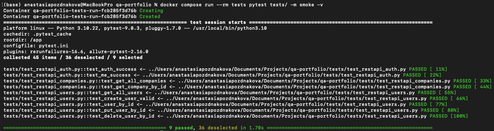
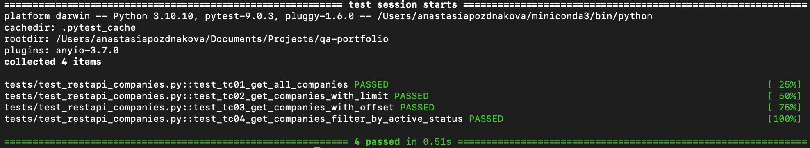
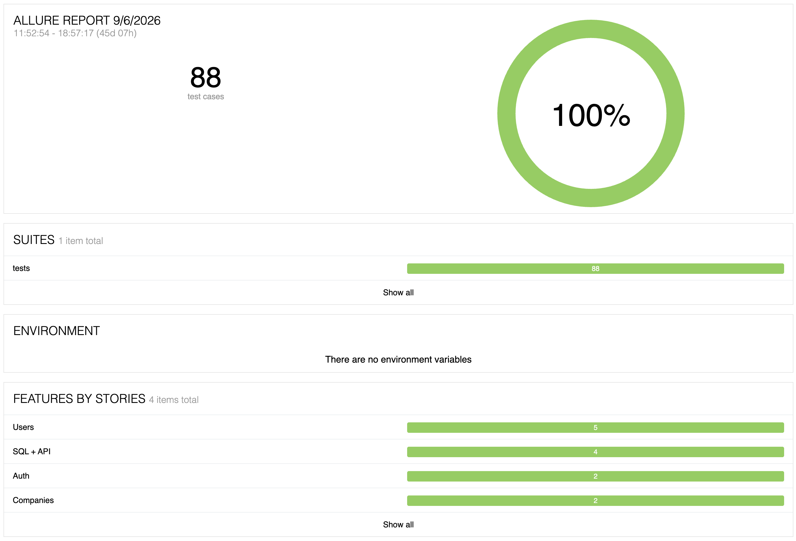

# QA — Backend Autotests

[](https://python.org)
[](LICENSE)
[](https://pytest.org)

Портфолио с автотестами для тестирования REST API (restapi.tech).  
Тесты написаны на pytest + requests, коллекция Postman прилагается.
Запуск возможен локально и через Docker.

---

## 🔧 Технологии

- **Python 3.10+** — основной язык программирования
- **pytest** — фреймворк для написания и запуска тестов
- **requests** — библиотека для выполнения HTTP‑запросов
- **Allure** — генерация отчётов
- **Docker / Docker Compose** — изолированный запуск тестов
- **Postman / Newman** — ручное и автоматизированное тестирование API
- **SQLite** — проверка данных через БД
- **GitHub Actions** — CI/CD

---

## 🗂 Структура проекта

| Путь | Описание |
|------|----------|
| `tests/test_restapi_companies.py` | pytest автотесты для `/companies` |
| `tests/test_restapi_users.py` | pytest автотесты для `/users` |
| `tests/test_restapi_auth.py` | pytest автотесты для `/auth` |
| `tests/test_api_sql.py` | тесты интеграции API + SQLite |
| `api/` | API-клиенты для `/companies`, `/users`, `/auth` |
| `data/` | Тестовые данные и ожидаемые статусы |
| `utils/helpers.py` | Вспомогательные функции |
| `postman/restapi-tech-collection.json` | Postman коллекция |
| `test-cases/` | Тест-кейсы в Markdown |
| `Dockerfile` | Инструкция сборки контейнера |
| `docker-compose.yml` | Настройка сервисов для запуска тестов |
| `requirements.txt` | Список зависимостей |
| `assets/` | Скриншоты результатов |
| `.gitignore` | Исключённые файлы |
| `LICENSE` | Лицензия MIT |
| `README.md` | Документация |

---

## 🐳 Запуск в Docker (рекомендуется)

### Требования
- Docker Desktop

### Запуск всех тестов
```bash
docker compose run --rm tests
```

### Запуск только smoke-тестов
```bash
docker compose run --rm smoke
```

### Запуск тестов с генерацией Allure-отчёта
```bash
docker compose run --rm allure
```

После этого отчёт появится в папке `allure-report`. Открыть его можно через `allure open allure-report` или просто открыть index.html.

### Полная сборка и запуск
```bash
docker compose up --build
```

### Очистка
```bash
docker compose down
```

---

## 🚀 Запуск локально

### Установка зависимостей

```bash
pip install -r requirements.txt
```

### Запуск всех тестов

```bash
pytest tests/ -v
```

### Запуск smoke-тестов

```bash
pytest tests/ -m smoke -v
```

### Генерация Allure-отчёта

```bash
pytest tests/ --alluredir=allure-results
allure generate allure-results -o allure-report --clean
allure open allure-report
```

---

## 📮 Postman коллекция

1. Откройте Postman.

2. Нажмите Import → выберите файл `postman/restapi-tech-collection.json`.

3. Создайте окружение (Environment) с переменной:
`BASE_URL = https://restapi.tech/api`

4. Запустите запросы и проверьте результаты тестов во вкладке Test Results.

### Запуск через Newman

```bash
newman run postman/restapi-tech-collection.json --environment postman/restapi-tech-environment.json
```

---

## 🧪 Покрытие тестами

### 🗄️ SQL + API интеграция

| Тест | Проверка | Статус |
|------|----------|--------|
| `test_sql_save_company_by_id` | Сохранение одной компании по ID в БД (параметризован: 1, 2, 3) | ✅ |
| `test_sql_save_all_companies` | Сохранение всех компаний в БД | ✅ |
| `test_sql_filter_companies_by_status` | Фильтрация компаний по статусу ACTIVE | ✅ |
| `test_sql_join_users_with_companies` | JOIN пользователей и компаний | ✅ |

### /api/companies и /{id}

| TC | Проверка | Статус |
|----|----------|--------|
| TC-01 | Базовый GET (структура, поля) | ✅ |
| TC-02, TC-06, TC-07 | Параметризованные тесты для `limit` (5, 0, "abc") | ✅ |
| TC-03, TC-08 | Параметризованные тесты для `offset` (2, -1) | ✅ |
| TC-04, TC-05 | Параметризованные тесты для `status` (ACTIVE, INVALID) | ✅ |
| TC-09 | Получение компании по ID (без Accept-Language) | ✅ |
| TC-10 | Получение компании с заголовком Accept-Language: RU | ✅ |
| TC-11 | Несуществующий ID (9999) | ✅ |
| TC-12 | Невалидный ID (abc) | ✅ |

### /api/users

| TC | Проверка | Статус |
|----|----------|--------|
| TC-13 | Базовый GET /users (структура, поля) | ✅ |
| TC-14, TC-16 | Параметризованные тесты для `limit` (5, "abc") | ✅ |
| TC-15 | Параметр `offset=2` | ✅ |
| TC-17 | Создание пользователя (201) | ✅ |
| TC-18, TC-19, TC-20 | Негативные сценарии POST (422, 404, 400) | ✅ |
| TC-21 | GET /users/{id} (200) | ✅ |
| TC-22, TC-23 | Параметризованные тесты для невалидного ID (404, 422) | ✅ |
| TC-24 | PUT /users/{id} (200) | ✅ |
| TC-25, TC-26, TC-27 | Негативные сценарии PUT (422, 404, 400) | ✅ |
| TC-28 | DELETE /users/{id} (202) | ✅ |
| TC-29, TC-31 | Параметризованные тесты для DELETE с невалидным ID (404, 422) | ✅ |
| TC-30 | Повторное удаление (404) | ✅ |

### 🔐 Auth

| TC | Проверка | Статус |
|----|----------|--------|
| TC-32 | Успешная авторизация | ✅ |
| TC-33 | Невалидный пароль (403) | ✅ |
| TC-34 | Короткий логин < 3 символов (422) | ✅ |
| TC-35 | Без поля `password` (422) | ✅ |
| TC-36 | /me с валидным токеном (200) | ✅ |
| TC-37 | /me без заголовка `x-token` (401) | ✅ |
| TC-38 | /me с невалидным токеном (403) | ✅ |
| TC-39 | Истечение токена (403) | ✅ |

---

## 🎯 CI/CD

При каждом пуше в ветку main запускается GitHub Actions:

1. Установка зависимостей

2. Запуск всех тестов

3. Генерация Allure-отчёта

4. Отправка результата в Telegram

---

## 🐳 Результаты тестов в Docker


---

## 📸 Результаты тестов



---

## 📊 Allure-отчёт



---

## 📄 Лицензия

Проект распространяется под лицензией MIT.

---

## 🔗 Ссылка на портфолио

https://github.com/Anastasia-Pozdnyakova/qa-portfolio

---

📫 **Контакты:** GitHub [Anastasia-Pozdnyakova](https://github.com/Anastasia-Pozdnyakova) · Telegram [@nastyapoze](https://t.me/@nastyapoze) · Email poznast59@ya.ru